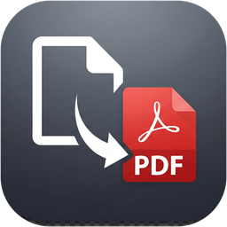

# Docx2PDF

<p align="center">
  
  <br>
  <strong>A lightweight, real-time DOCX to PDF converter for Windows</strong>
  <br>
  <em>Created by Akib</em>
</p>

---

## Overview

**Docx2PDF** is a modern Windows desktop application that watches a selected folder and all its subfolders recursively. Whenever a `.docx` file is created or updated, it converts it into a `.pdf` file in real-time.

---

## Features

- **Live Real-Time Monitoring**: Automatically detects added, modified, or renamed Word documents across nested subdirectories.
- **Smart Dual-Engine Conversion**:
  - **LibreOffice Headless Engine**: Produces 100% Word-matching fidelity with complex fonts, shapes, tables, and page layouts.
  - **Built-in OpenXML + PDFSharp Engine**: Zero-dependency standalone fallback when LibreOffice is not installed.
- **Background Tray Mode**: Minimizing or closing `Docx2PDF` hides it directly into the Windows System Tray, continuing conversions quietly in the background without cluttering your taskbar.
- **Single-Instance Protection**: Clicking the app shortcut while it is already running automatically unhides and brings the existing window to the foreground, preventing duplicate processes.
- **Instant Folder Switching**: Changing folders midway immediately cancels in-progress jobs and focuses resources on the new directory.
- **Bounded Concurrency & Low Footprint**: Operates with bounded parallel workers, maintaining low CPU usage and memory footprint (< 150 MB RAM).

---

## Getting Started

### Installation
1. Go to the [Releases](https://github.com/akibsaif39/Docx2PDF/releases) section.
2. Download **`Docx2PDF_Install.exe`** (or `Docx2PDF_Setup.msi`).
3. Run the installer and launch **Docx2PDF**.

### Building from Source
Requirements: [.NET 8.0 SDK](https://dotnet.microsoft.com/download/dotnet/8.0) or later on Windows.

```powershell
# Clone the repository
git clone https://github.com/akibsaif39/Docx2PDF.git
cd Docx2PDF

# Run tests
dotnet test Docx2PDFLive.slnx

# Publish self-contained single-file executable
dotnet publish Docx2PDFLive.UI/Docx2PDFLive.UI.csproj -c Release -r win-x64 --self-contained true -p:PublishSingleFile=true -o publish
```

---

## License

This project is licensed under the [MIT License](LICENSE).
